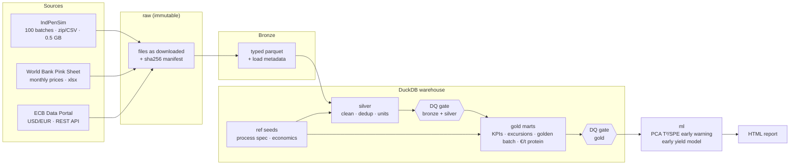

# ferment-ops

An end-to-end data pipeline for a biomass-fermentation business, built entirely on **public data**:
bioreactor sensor data, feedstock and protein-market prices, and FX rates go in; a governed warehouse,
data-quality gates, an ML early-warning model and a decision report come out.

It is a portfolio project inspired by the problems a company like MicroHarvest faces when scaling
microbial protein from a pilot plant to an industrial site. **It uses no MicroHarvest data.**


---

## What questions it answers

| Question | Where |
|---|---|
| Which batches and control regimes give the best yield on sugar? | `gold.fct_batch_kpis`, report §1 |
| Is a running batch drifting away from a "golden batch"? | `gold.fct_golden_batch_profile`, report §2 |
| Can we catch a process fault within hours, before the batch is lost? | `ml.mspc_batch_alarms`, report §3 |
| What will this batch yield, predicted at hour 60? | `ml.yield_predictions`, report §4 |
| What does feedstock cost per tonne of protein, compared with fishmeal and soy? | `gold.fct_protein_unit_economics`, report §5 |
| Can I trust these numbers? | `dq.check_results`, report §6 |

## Architecture



Orchestration: `orchestration/airflow/dags/fermentation_pipeline_dag.py` runs the three ingestions in parallel,
then the transform with its quality gates, then ML and the report. The DAG calls the same functions as the CLI.

## Data sources

| Source | What it stands in for | Access pattern | Licence |
|---|---|---|---|
| [IndPenSim](https://data.mendeley.com/datasets/pdnjz7zz5x/1) (Goldrick et al., Univ. of Manchester / UCL) – 100 simulated batches of a 100,000 L industrial fed-batch fermentation, 39 process variables + Raman spectra. Batches 1–30 recipe-driven, 31–60 operator-controlled, 61–90 Raman/APC, 91–100 contain faults. | Bioreactor historian + LIMS data | Bulk zip download, streamed CSV | CC BY 4.0 |
| [World Bank Commodity Price Data (Pink Sheet)](https://www.worldbank.org/en/research/commodity-markets) – monthly sugar, soybean meal, fishmeal and more | Feedstock cost and competing protein prices | Excel file, layout-tolerant parser, URL discovery fallback | CC BY 4.0 |
| [ECB Data Portal](https://data.ecb.europa.eu/help/api/data) – `EXR.M.USD.EUR.SP00.A` | Converting USD market prices to EUR | SDMX REST API (`format=csvdata`) | Free reuse with attribution |

## Quick start

```bash
git clone https://github.com/mr1000lights/ferment-ops.git
cd ferment-ops
python -m venv .venv && source .venv/bin/activate
pip install -e ".[dev]"

make sample     # offline: synthetic files with the same layout as the real sources (~15 s)
make live       # real data: downloads IndPenSim (~0.5 GB) + World Bank + ECB, then runs everything
make test       # 13 tests: parsers, SQL logic, DQ gate, ML, report
```

Open `reports/fermentation_report.html`. Individual steps:

```bash
fdp ingest --mode live [--source indpensim|worldbank_pinksheet|ecb_fx] [--force]
fdp transform     # silver → DQ gate → gold → DQ gate
fdp ml            # MSPC early warning + yield model
fdp report
```

Explore the warehouse directly: `duckdb data/warehouse/fdp.duckdb` → `SELECT * FROM gold.fct_batch_kpis LIMIT 10;`

## Repository layout

```
config/pipeline.yaml          sources, process spec, economics assumptions, ML settings
src/fdp/ingest/               one connector per source: download → manifest → bronze
src/fdp/sample_data.py        offline files with identical layout (CI and demos)
src/fdp/warehouse.py          DuckDB: bronze views, reference seeds, ordered SQL models
sql/silver/*.sql              cleaning and conforming (one file = one table)
sql/gold/*.sql                business marts
src/fdp/quality.py            17 data-quality checks, results persisted per run
src/fdp/ml/early_warning.py   PCA-based MSPC (T², SPE) + early yield regression
src/fdp/report/               self-contained HTML report (Plotly)
orchestration/airflow/        Airflow DAG
tests/                        pytest suite (runs the whole pipeline on sample data)
.github/workflows/ci.yml      lint, tests, sample run, report as build artifact
```

## Data model (gold)

| Table | Grain | Highlights |
|---|---|---|
| `dim_batch` | batch | control regime, fault flag, duration |
| `fct_batch_kpis` | batch | product mass, sugar fed, **yield kg/kg sugar**, productivity, DO/pH/temperature stability, excursions, share of time outside golden envelope, reconciliation to source statistics |
| `fct_process_excursions` | excursion | gaps-and-islands runs of ≥ N consecutive out-of-spec samples per variable |
| `fct_golden_batch_profile` | 2-hour bucket | 5th / 50th / 95th percentile bands from normal batches |
| `fct_commodity_prices_eur` | commodity × month | USD/t → EUR/t with the ECB monthly rate |
| `fct_protein_unit_economics` | month | molasses feedstock €/t protein vs fishmeal and soybean meal €/t protein; annual feedstock bill at 15,000 t/yr |

## Data quality

Checks run in two gates and are stored in `dq.check_results` with a run id, so quality can be trended over time.
`error` checks stop the pipeline; `warn` checks are reported. Examples:

* **Completeness**: 100 batches derived, statistics cover every batch, required commodities present
* **Validity**: physical ranges for pH, temperature, concentrations; plausible FX
* **Uniqueness**: one row per (batch, time) and per (commodity, month)
* **Consistency and reconciliation**: derived batch id matches the source label; computed product mass correlates with source-reported harvest; every commodity month joins to an FX rate
* **Freshness**: FX data no more than 3 months old

## Source quirks handled (and tested)

* **~2,200 Raman spectrum columns** are dropped at read time so the 2.5 GB uncompressed CSV streams in chunks.
* **Column labels** look like `pH(pH:pH)`. Columns are mapped on the short code in brackets, so cosmetic label changes don't break ingestion.
* **Shifted batch-reference labels** in the published CSV: `batch_id` is derived from the time reset between batches and reconciled against the shifted column in a DQ check.
* **Pink Sheet layout drift**: the header row is located dynamically, units are normalised ($/kg → $/t), discontinued series (`…`) become NULL, and if the yearly file URL changes, the connector finds the new link on the World Bank page.

## ML: early warning and yield forecast

* **Multivariate statistical process monitoring (MSPC)**, the standard approach in biomanufacturing. Each variable is normalised against the normal-batch profile at the same batch hour. A PCA model is fitted on normal batches 1–75. Every sample gets a Hotelling T² and an SPE score, with 99th-percentile control limits. A batch is flagged after 10 consecutive alarms (2 h). The model is evaluated on unseen normal batches 76–90 (false-alarm rate) and fault batches 91–100 (detection rate and delay against the recorded fault start).
* **Early yield forecast**: a ridge regression on features from the first 60 h predicts final product mass, cross-validated against a naive baseline.

## Design choices

* **DuckDB + SQL files** instead of a cluster: the whole platform runs on a laptop and in CI in seconds. The SQL is plain ANSI-style and ports to Databricks/Spark SQL with minor changes. On Databricks, the layers become Delta tables, the DQ checks become expectations, and the DAG becomes a Workflow.
* **Raw zone is immutable and checksummed** (`data/raw/_manifest.jsonl`), so any report can be traced back to the exact file it came from.
* **Assumptions live in config**, not in code (process spec, protein contents, yields), so a process engineer can challenge them without reading Python.
* **Sample mode with identical file layouts** keeps CI hermetic and lets reviewers run the project without downloading 0.5 GB.

## Limitations

* IndPenSim simulates **penicillin** fermentation, not single-cell protein. It is used because it is the largest public, industrial-scale fermentation data set with labelled faults. The pipeline patterns transfer; the process limits in `config/pipeline.yaml` must be replaced with real specifications.
* The unit-economics model covers **feedstock only** (no energy, nitrogen, capex or downstream processing). Molasses is priced as a fixed share of world sugar because no free molasses price series exists.
* The process spec limits and ML thresholds are starting values. Tune them on the live data (for example, `consecutive_alarms` trades detection delay against false alarms).

## How this would grow in production

1. Replace file ingestion with a historian/OPC UA or MQTT stream for bioreactor data, plus a LIMS connector for lab results.
2. Move bronze/silver/gold to Delta Lake on Databricks; manage models with dbt, the catalog and lineage with Unity Catalog or Collibra.
3. Serve the MSPC model in near real time, with alerts to shift operators. Retrain per site (Lisbon pilot vs Leuna) and per product.
4. Add batch genealogy: feedstock lot → fermentation batch → product lot, for feed and food traceability.

---

Built by **Manohar Mandalapu** · data engineer · [github.com/mr1000lights](https://github.com/mr1000lights)
